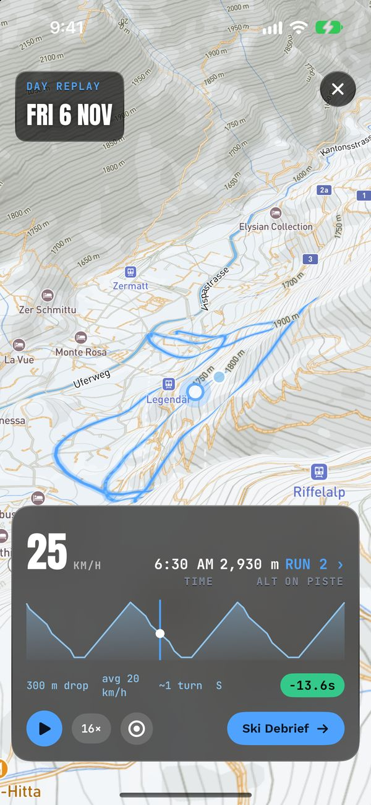
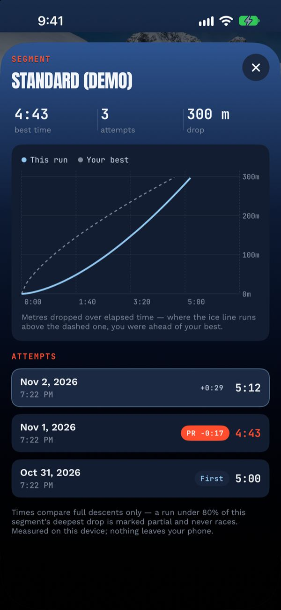

# Ghost racing: racing yourself down a ski run

Racing video games have the
[*ghost*](https://en.wikipedia.org/wiki/Glossary_of_video_game_terms#Ghost),
a replay of your fastest lap driving alongside you. Strava's
[Live Segments](https://support.strava.com/hc/en-us/articles/207343830-Live-Segments)
do something similar for rides and runs, pitting you against your PR
on a segment. Skiing is harder, because ski runs don't have start
gates and finish lines.

In a way they do, though: [OpenStreetMap maps pistes](https://wiki.openstreetmap.org/wiki/Pistes),
and mappers name them. If an app can tell which named run you're
descending, every run becomes a segment and your own history becomes
the ghost.

## How does ghost racing work in a ski app?

When you ski a named run, Alpy matches your GPS line against the OSM
piste network with a majority vote inside a 40 m corridor (off-piste
lines match nothing, which is the honest result). Ski the same run
again and the app finds your fastest *full* previous descent and
races you against it, live on the mountain and in the replay.

While you ski, a race card appears with an F1-style gap that ticks in
real time: green −1.2 s when you're up on yourself, +0.8 s in the
theme's accent colour when the ghost is ahead. In the replay, your
best descent is drawn as a second dot on real 3D terrain, running
beside today's line.

## How is a race against your own ghost kept fair?

There are two guards. A partial descent never races a full one.
Bailing halfway down in half the time isn't a record, so any attempt
under 80% of the segment's deepest recorded drop is marked partial
and excluded. And the gap is computed by *vertical progress* instead
of clock time at a position. The app asks when the ghost reached the
depth you're at now, which works even though no two GPS lines down a
piste are identical.

There's no leaderboard against strangers and no server keeping score.
You race who you were, and on the fourth run of the day with your
legs going, that's opponent enough.

*Ghost racing is free in Alpy, like everything else.
[How it compares to other ski apps](/compare/).*
