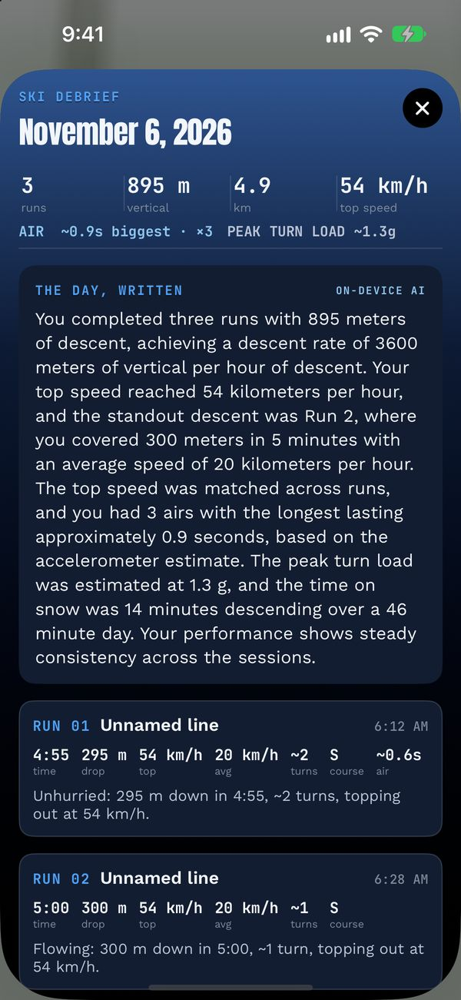

# Counting ski turns from GPS: an honest estimate

Alpy's debrief shows "~14 turns" for a run, and the tilde is there on
purpose. This post covers how a phone counts turns, and why any app
showing you a turn count *without* a tilde is overselling its data.

## How does a phone count ski turns?

From heading swings. A GPS track is a chain of fixes, and the
direction from one fix to the next is a heading; skiing linked turns
swings that heading left-right-left in a rhythm. Alpy adds up the
swing in one direction, and when the direction flips after at least
30°, it counts a turn. A smaller swing that reverses is treated as
jitter and discarded, and steps under 5 m are ignored for the same
reason.

The method only reads heading, so it doesn't care whether the turn
was a carved arc, a skidded snow-plough or a snowboard turn.

What it can't see is a turn shorter than the gap between GPS fixes.
Alpy asks iOS for a new fix only after about 10 m of travel, so tight
short-radius turns that happen between a couple of fixes blur
together, and the estimate reads low. That's why it's "~14" and never
"14."

## Why bother with an imperfect count?

Because the *trend* is more honest than the number. Turn cadence
(turns per minute, run by run) barely depends on absolute accuracy:
if the method undercounts consistently, the day's curve still shows
the real pattern. Alpy plots exactly that as a Day Rhythm chart, and
with four or more comparable runs it will give a verdict such as
"cadence faded 22% by day's end", comparing the first half of your
runs with the last half. With three runs it refuses to claim a trend,
because small samples make confident liars.

Estimates are fine instruments as long as they're labeled, and on a
turn count the tilde is the label.

*Turn estimates, cadence and the day debrief are free in Alpy.
[About](/).*
