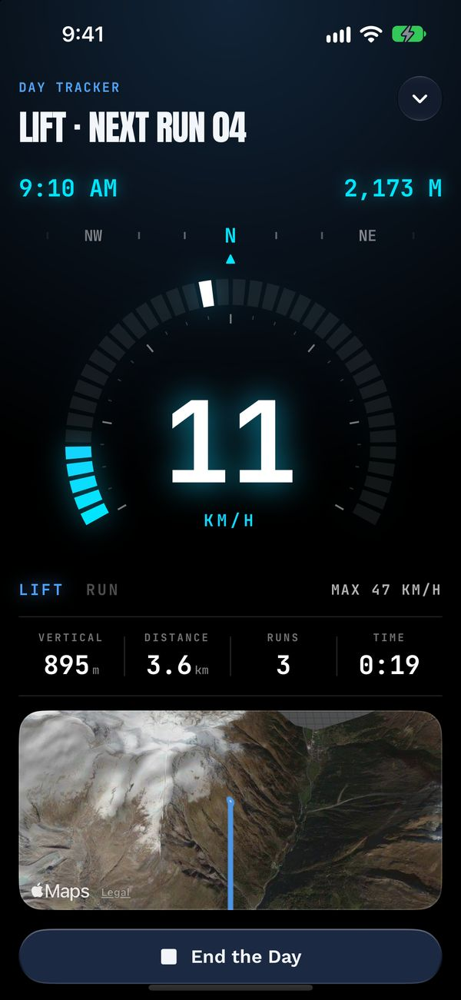

# How ski apps measure vertical, and why GPS lies about it

Ask your phone where you are and, under open sky, it's
[typically within about 5 m](https://www.gps.gov/gps-accuracy).
Ask it how *high* you are and it does worse. Vertical error is GPS's
weakest axis (typically
[two to three times the horizontal error](https://pmc.ncbi.nlm.nih.gov/articles/PMC12349078/)),
and the same study measured larger position errors at Zermatt than
at Davos, where the terrain blocked more of the sky.

For a ski tracker this matters. Vertical drop is the number skiers
brag about, and run detection works by watching altitude trends. If
raw GPS altitude wobbles by metres from fix to fix, a parked phone
"descends" and "climbs" all afternoon.

## What does a phone use to measure altitude?

Two instruments: GPS and a barometric altimeter, which many iPhones
carry alongside it (not every device has one, which is why Apple's
[altimeter API](https://developer.apple.com/documentation/coremotion/cmaltimeter)
asks apps to check first). GPS gives an absolute height but wobbles;
the pressure sensor on its own only tells you how your height is
*changing*. Neither is good enough alone for honest ski vertical, so
you combine them.

Apple's Core Motion exposes the barometer as a
[relative altitude](https://developer.apple.com/documentation/coremotion/cmaltitudedata/relativealtitude):
the change in metres since the first reading. Since iOS 15 it also
offers an
[absolute altitude](https://developer.apple.com/documentation/coremotion/cmabsolutealtitudedata)
(height above sea level, with its own accuracy estimate) on iPhone 12
and later. Alpy uses only the relative stream and does its own
anchoring, described below.

A pressure sensor can't tell a change in height from a change in the
weather. By the FAA's rule of thumb,
[an inch of mercury of pressure reads as 1,000 feet](https://www.faa.gov/air_traffic/publications/atpubs/aim_html/chap7_section_2.html)
(about 9 m per hectopascal), and the Met Office classes a change of
[more than 6 hPa in three hours](https://www.metoffice.gov.uk/weather/guides/coast-and-sea/glossary)
as "very rapid". A fast-moving weather system can therefore shift a
barometer's baseline by tens of metres over a few hours.

So you have one instrument that's anchored but noisy, and one that's
smooth but unanchored.

## How do ski apps combine the barometer and GPS?

By fusing them: take the barometer's smooth *shape* and pin it to
GPS's absolute *level* with a slowly learned offset. The offset has
to adapt over minutes rather than seconds, so it absorbs weather
drift without re-importing GPS wobble.

This is what Alpy does while you track. Every recorded fix rides the
fused altitude, so run detection and vertical totals use it. In a
simulated unit test (synthetic GPS wobble of up to ±18 m and an
ideal barometer) the fused altitude's error is under 35% of raw
GPS's; we haven't yet measured it against surveyed truth on real
ski days. On phones without a barometer the app falls back to GPS
altitude alone.

*Alpy is a free ski app for iPhone with no account and no ads, and
your GPS never leaves the phone. [What it does](/).*
