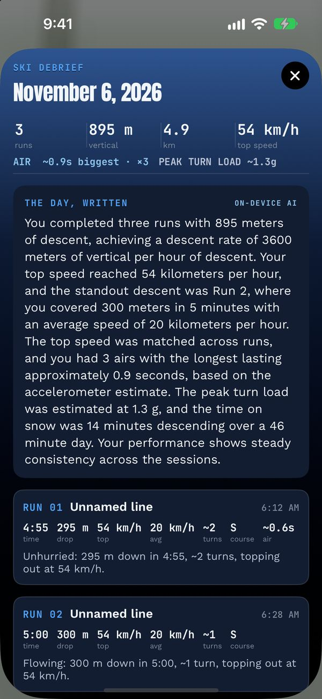

# On-device AI for skiers: a morning report that never phones home

iPhones that support Apple Intelligence carry a language model *on
the device* that apps can use through Apple's
[Foundation Models framework](https://developer.apple.com/documentation/foundationmodels/systemlanguagemodel).
Apple
[says](https://www.apple.com/newsroom/2025/09/apples-foundation-models-framework-unlocks-new-intelligent-app-experiences/)
the inference is free, private and available offline, on any
Apple Intelligence-compatible device with Apple Intelligence turned
on. For an app like Alpy that changes the trade-off completely. We
get readable prose with no cloud bill and no API key, and none of
your data leaves the phone.

## What does on-device AI do in a ski app?

In Alpy it writes, and that's all it does. Apple's on-device model
turns measured numbers into plain sentences in two places: the
morning report, a few sentences putting today's measured conditions
into plain language, and "The Day, Written", an end-of-day paragraph
in your debrief. Its instructions forbid inventing facts or adding
numbers it wasn't given, and every paragraph it writes is labeled as
AI.

Both run under the same contract we'd give a careful human editor:
*rephrase the telemetry, never invent.* The model receives only
measured facts (temperatures, fresh snow, your run times, your PRs,
your cadence trend) and, for the morning report, the avalanche
bulletin's own text, with explicit instructions to add nothing. In
the day summary, facts that don't exist for the day are left out of
the prompt entirely, so the model is never handed airtime to mention
on a day without airs. Apple's own
[guide to the on-device model](https://developer.apple.com/documentation/foundationmodels/generating-content-and-performing-tasks-with-foundation-models)
points tasks that need extensive world knowledge at extra tools, so
we don't ask it for world knowledge at all. You won't get "best runs
at Verbier" from a model that might make them up.

One exception, so nobody is surprised: the resort guides on the
Resort tab (a resort's character, run picks, food and après) were
written ahead of time by a cloud model, Anthropic's Claude, from its
general knowledge, and ship inside the app. Each one is labeled with
the model and the month it was written, plus a warning that names
can drift, so check runs on the trail map. Nothing in the app
contacts an AI service while you use it.

## How do you know when a ski report was written by AI?

Every AI-written paragraph in Alpy is labeled. The two on-device
ones carry a chip saying who wrote them: ON-DEVICE AI when Apple's
model is available, and AUTO (on the morning report) or AUTO SUMMARY
(on the debrief) when the phone falls back to our deterministic
template. The template gets the same measured inputs and only the
voice differs, and either way the chip tells you which one you're
reading. AI output is never the safety source. The bulletin's danger
level and the weather numbers are shown as their providers publish
them, above the prose.

*Alpy is free, and the AI that runs in the app runs on your phone.
[Privacy policy](/privacy/).*
