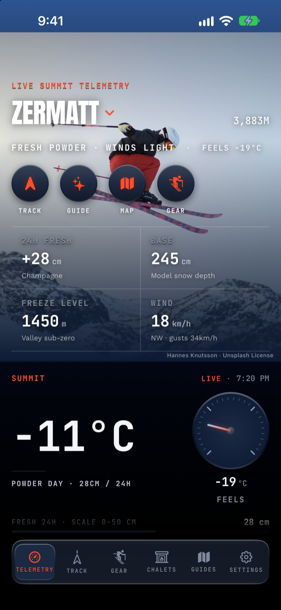

# A first ski day with Alpy, start to finish

I wish every app had a walkthrough like this one, going through a ski
day hour by hour instead of listing features. I built Alpy, so treat
this as the maker's intended path through it, and then bend it to your
own day.

## How to use Alpy on a first ski day

Read the morning report, pick your runs on the 3D map, press Start
Tracking once, and let it run. Runs and lifts are detected
automatically, so there's nothing to tap at each lift. When you stop
tracking, the day turns into a replay, a per-run debrief and a
written summary, all on the phone and with no account.

1. 7:00: read the morning report on the Telemetry page.
2. 7:40: pick where to go on the 3D winter map.
3. 9:00: press Start Tracking, once.
4. 12:30: glance at the on-hill screen and leave it alone. It's built
   to be read in three seconds.
5. 16:30: watch the light if the day runs long.
6. 17:00: stop tracking and read the debrief.

### 1. The morning report (7:00)

Open the app and the Telemetry page is already a cockpit: summit
temperature with feels-like, 24-hour fresh snow, base depth, wind
and gusts, and the freeze-level curve. That curve is Open-Meteo's
hourly freezing level from six hours ago to 24 hours ahead, drawn
against the resort's base and summit heights. If there's an
avalanche bulletin for your region, it's there with the
[EAWS danger level](https://www.avalanches.org/standards/avalanche-danger-scale/),
and when the bulletin names dangerous slope aspects, a compass rose
shades them in.

Below that is a morning report in prose. On iPhones with Apple
Intelligence turned on, it's written by Apple's model **on your
phone**. The AI is told to use only the measured numbers above it and
never to invent anything, and the card says which voice wrote it.

### 2. Deciding where to go (7:40)

The trail map opens on a 3D winter mountain: real terrain, snow-white
with relief shading, and the resort's actual piste network drawn over
it in difficulty colors. At Zermatt that's about 126 km of mapped
runs from OpenStreetMap, and catalog resorts' maps are bundled in the
app. Tap a run in the list and it lights up on the mountain while the
camera flies to it. One tap switches to a flat paper chart when you
just want the diagram.

### 3. Start Tracking (9:00)

It's one button. From here the app measures your day. Runs and lifts
are detected automatically from altitude trends, so there's nothing to
start or stop at the top of each run. The live cockpit shows your
speed and the drop of the current run. If you've skied a named run
before, it also shows a live ghost race against your own best time,
with the gap shown like a race timing board.

When the day is saved, the app estimates how long you stood in each
lift line (standing-still GPS just before boarding), and if a
bulletin is active, your debrief will flag any run whose course
pointed into the named aspects.

### 4. The glance test (12:30)

On the hill, the useful screen is the one you can read in three
seconds with gloves on, so it has big numerals and no menus. If your
battery drops to 10% while it isn't charging, the app stops tracking,
**saves the day** and sends you a notification saying so, rather than
risking the phone dying with the day unsaved.

### 5. Last run (16:30)

If the day runs long, a chip appears while tracking in the last 45
minutes before sunset. It shows the sunset time and the minutes of
light left, counted from Open-Meteo's sunset time for the resort. It
states the fact and leaves the call to you.

### 6. The debrief (17:00)

When you stop tracking, the day becomes three things:

1. A replay of your line drawn over the 3D winter terrain, with a
   chase camera that follows your dot down each run at up to 32×, and
   your ghost alongside where you've skied the run before.
2. A debrief listing every run as a register entry: time, drop, top and
   average speed, estimated turns, course, and an airtime estimate
   when the accelerometer caught a jump. On days with at least two
   minutes of queueing it adds lift-line totals per lift, and it shows
   personal records with the margin you beat them by.
3. A written summary, a coach-style paragraph built only from your
   measured numbers: descent rate, time-on-snow, the standout run and
   consistency. It uses on-device AI again where the phone has it and
   a template where it doesn't, and it's labeled either way.

## Does Alpy upload your ski day anywhere?

No. You created no account, no GPS point left the phone, and nothing
was uploaded, because there is no server to upload to. Alpy is built
without one, so there's no setting to get wrong.

[Alpy is free on the App Store](/), with no subscription and no ads.
If you try it for a first day, the [season-opening checklist](/blog/season-opening-checklist/)
pairs well with it.
