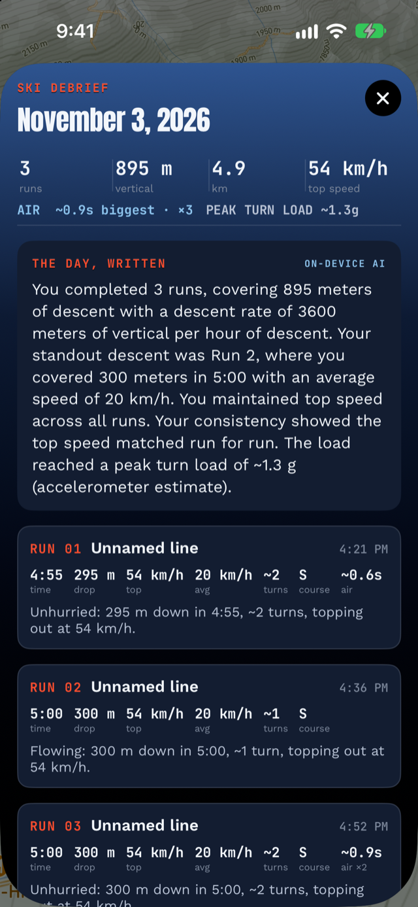

# Lift lines: the only honest queue tracker has your name on it

Every skier knows the feeling: the day felt great, but somewhere an
hour evaporated into lift queues. Alpy now measures that hour — and
tells you which lifts ate it.

## How can a ski app measure lift line wait times?

From your own GPS. Working from your saved day's track, the app looks at
the gap between each run's end and the following lift ride, scanning
**backwards** from the moment the climb starts and adding up the
time you were essentially stationary (under about 0.6 m/s —
standing, with shuffle-forward moments tolerated).

Scanning backwards matters: it's what keeps your
lunch out of the number, because the walk from the restaurant to the
lift breaks the standing streak. The result is labeled an estimate,
because GPS genuinely cannot tell a lift line from you finishing a
sandwich at the base.

Each wait is then matched to a **named lift** by comparing the ascent
that follows with the resort's OpenStreetMap
[lift lines](https://wiki.openstreetmap.org/wiki/Key:aerialway) — your track
hugs the lift you actually rode.

## What you see

In the day's debrief, a Lift Lines card: total minutes waiting, then
a bar per lift — "Gondola · ×3 … ~11 min". Once a lift has four rides
in your history, a season line appears underneath with average wait
and ride count; from six rides it adds a morning/afternoon split
(before and after noon). That last one is the quietly useful number:
if a lift queues in the morning and walks on after lunch, after a few
tracked days *your own data* shows it.

Walk-on rides count as zero-minute waits on purpose. If they didn't,
"average wait" would secretly mean "average wait when there was a
line" — a worst case dressed up as a typical one.

## Can Alpy show live lift queues?

No. Live crowd numbers would need many skiers' positions pooled on a
server. Alpy has no server, no accounts, and sends nothing off your
phone — that's a founding constraint, not a missing feature. So the
card says what it is: *"Your own days only — nothing is shared, so
this can't see today's crowds, only your history with them."* For
planning your own week at your own resort, we think that history is
most of what you want anyway.

*Lift Lines appears automatically in the [Ski Debrief](/blog/first-day-with-alpy/)
of any tracked day with at least two minutes of queueing. Free, like
the rest of [Alpy](/).*
