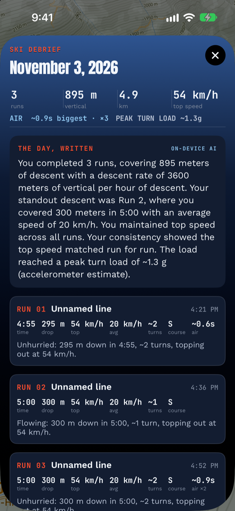

# The Day, Written: a coach's debrief from your own numbers

The end of a ski day produces a pile of numbers, and most apps show
you the pile. Alpy also *reads* it to you in a short paragraph, in the
voice of a coach going over the data. It's built from these athletic
measures:

- Descent rate: vertical meters per hour *of descending*. To us it's
  the clearest "how hard did I ski" number.
- Time on snow: how much of your mountain day was actually spent
  descending (for example, "41 min descending across a 3 h 12 m
  day").
- The standout run: the run with your highest average speed, with its
  drop, time and speed.
- Records: personal bests on named runs, with the margin you beat
  them by.
- Consistency: how tightly your per-run top speeds grouped.
- Conditioning: whether your turn cadence held, rose, or faded across
  the day.
- Load: airtime and peak turn G from the accelerometer, always
  labeled as the estimates they are.

## Can an AI ski summary make up numbers?

It's built not to. The paragraph is written by Apple's
[on-device model](https://developer.apple.com/documentation/foundationmodels/systemlanguagemodel)
when your iPhone has one, and by a deterministic template when it
doesn't, and the card labels which voice you're reading. The model's
instructions set the rules: **use only the facts provided; never
invent conditions, snow, weather, places, people, technique advice
or feelings; do not add numbers that are not given.** The template
can only print the facts it is handed.

Facts your day didn't produce are left out entirely, with no padding
around the gap. If you set no records, no record line is in the
prompt or the template.

We didn't want flattery or filler. The prompt hands the model a fixed
set of measured sentences, and its only job is to make them read
well, so it rephrases and doesn't author anything. When the model
isn't available, the template assembles the same facts in the same
register, so the facts you're given don't change with the hardware.

## Why "athletic" framing

Early versions of this feature read like a diary: pleasant and
forgettable. The rewrite treats your day the way a coach treats a
training log, with work done first, quality second and trend third.
Skiing is a sport, so I wanted the debrief to use the sport's
vocabulary.

Everything is computed on the phone from your own GPS and motion
sensors, so the debrief has the same privacy as the rest of
[Alpy](/): no account, no server, nothing uploaded.

*The Day, Written sits at the top of every Ski Debrief. For the rest
of the debrief (per-run registers, lift lines, records), start with
[a first day with Alpy](/blog/first-day-with-alpy/).*
