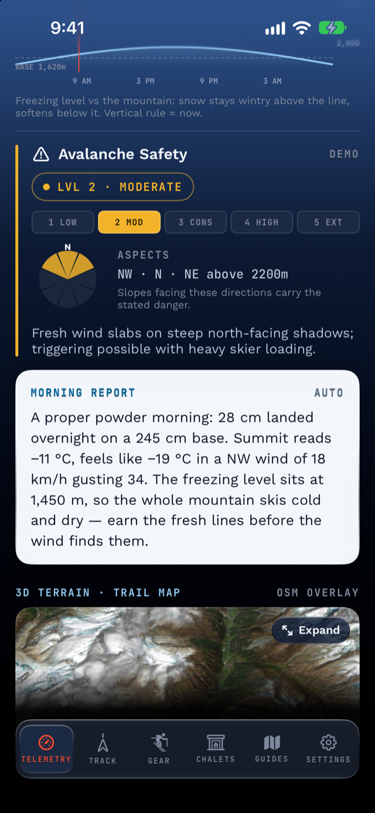

# Skiing safer with data: the aspect rose and the last-run light

Alpy's rule for safety features is strict: state measured facts,
keep advice to a single line at most, and never let an estimate
dress up as a measurement. Two new instruments live under that rule.

## What is an avalanche aspect rose?

A compass rose with the dangerous slope directions filled in. Avalanche
bulletins don't just publish a danger level — many name the
*aspects*: which compass directions of slope carry the problem
(for example, "NW–NE above 2200 m"). North American forecasts draw
this as a
[distribution rose](https://avalanche.org/avalanche-encyclopedia/human/resources/avalanche-forecasts/distribution-rose/):
eight compass slices with the problem's sectors shaded.

Alpy already showed the level on the official
[1–5 scale](https://www.avalanches.org/standards/avalanche-danger-scale/);
now, when the bulletin feed includes aspects (SLF's does; the
avalanche.org feed Alpy reads doesn't), they're drawn the same way —
a rose with the dangerous sectors filled in the danger color.

One honest detail: when a bulletin publishes finer-grained aspects
than the eight-point rose (say "NNE"), Alpy ignores that string
rather than rounding it to a neighbor. We don't guess with safety
data.

### …checked against your actual day

Here's the part no printed bulletin can do. In the debrief of a
tracked day, any run whose measured course fell into the bulletin's
named aspects gets a quiet flag. The footnote states the physics
plainly: your descent course stands in for the slope's aspect (the
fall line descends the way the slope faces) — a proxy, not a slope
measurement — and the flag matters *beside and beyond* the groomed
runs, not on them: SLF's bulletin, for instance,
[only covers unsecured terrain](https://www.slf.ch/en/avalanche-bulletin-and-snow-situation/about-the-avalanche-bulletin/capabilities-and-limitations-of-the-avalanche-bulletin/),
away from secured ski runs and pistes. The flag
also never applies to past days judged against today's bulletin;
that comparison would simply be false.

## How does Alpy warn you about fading light?

With a fact, not an alarm. While you're tracking a day, Alpy knows
the resort's forecast sunset. When you're inside the final 45
minutes of light, a chip appears in the live cockpit — sunset time,
minutes remaining — and after sunset it says, plainly, that the light
is going. No push notifications, no nagging, no advice about what you
should do. A fact, stated at the moment it's relevant.

## Why so restrained?

Because trust in a safety feature is spent the first time it
exaggerates. An app that says "DANGER: turn back!" is guessing about
your situation; an app that says "bulletin names NW–NE above 2200 m;
your run 4 pointed N" is handing you the bulletin's own facts,
aligned with your own track. The judgment stays where it belongs —
with the person on the snow. For how to read the bulletin itself,
see [how to read an avalanche bulletin](/blog/reading-avalanche-bulletins/).

*Both instruments are free in [Alpy](/), like everything else. The
bulletin data comes from the official warning services
([SLF](https://www.slf.ch/en/), [avalanche.org](https://avalanche.org/));
when a region has no bulletin, the app says exactly
that instead of inventing one.*
