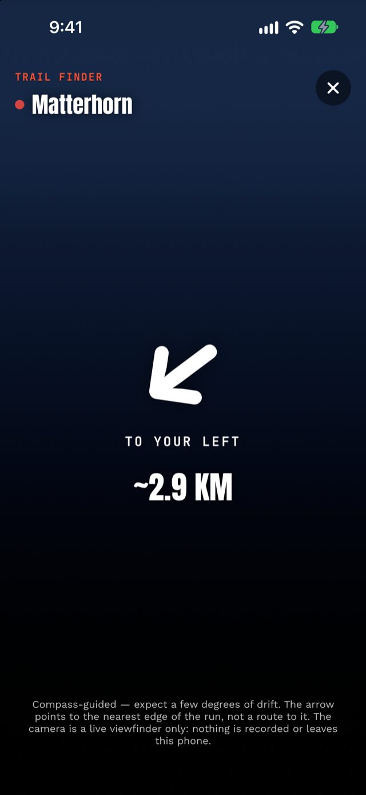

# Trail Finder: point your phone at the mountain

You're standing at a junction of four pistes in flat light, the
signpost is rimed over, and the run you wanted is… somewhere. Trail
Finder is Alpy's answer: pick a run on the trail map, tap **Find**,
and point your phone at the mountain. A live arrow swings toward the
run's nearest edge over your camera view — "AHEAD · ~340 M" — and
keeps pointing as you turn.

## How does Trail Finder know where the run is?

No magic: your GPS position, the run's real
[OpenStreetMap geometry](https://wiki.openstreetmap.org/wiki/Pistes),
and the phone's compass. The app computes the bearing from you to the
nearest point of the run (a named run is often several mapped
segments; it picks the closest), compares it with the direction
you're facing, and rotates the arrow by the difference. Face within
25° of the run and the arrow reads "AHEAD" in the app's accent
color; face more than 150° away and it says so plainly: "BEHIND YOU."

## Why doesn't Trail Finder draw an AR line on the snow?

Because a phone compass isn't accurate enough to be sure the line
lands on the right piste. The obvious flashy version is an augmented-reality line
painted on the snow, showing the run snaking down the face. We ran
the idea against the geometry and said no.

A phone compass's heading carries an error measured in degrees —
iOS reports its own estimate as
[`headingAccuracy`](https://developer.apple.com/documentation/corelocation/clheading/headingaccuracy),
and flags the heading invalid when the phone is uncalibrated or near
strong magnetic interference. At 500 m, every 5° of heading error
moves a drawn line about 44 m sideways, which means the "painted
run" can sit on the *neighboring* piste. An arrow is robust to that error; a painted line pretending to
centimeter accuracy is a lie wearing good graphics.

The HUD says this on screen: *"Compass-guided — expect a few degrees
of drift. The arrow points to the nearest edge of the run, not a
route to it."* Terrain between you and that edge is yours to judge.

## Does Trail Finder record video?

No. The viewfinder is exactly that. The camera session in Trail Finder
has **no recording output attached** — frames go to your screen and
physically nowhere else. No photo, no video, no analysis, no upload.
That's stated in the [privacy policy](/privacy/) and enforced by the
code's architecture, not by a promise.

## When it's most useful

- Junctions in fog or flat light, when signage fails.
- Finding the *entrance* of a run you've only seen on the map.
- Orienting after a lift you've never ridden — point the phone,
  sweep, and the arrow tells you which way your run lies.

It's a small tool with one honest job. Pick a run, tap Find, trust
the arrow's direction but allow for compass drift — and keep your eyes on the
mountain, not the phone.

*Trail Finder is in [Alpy](/), free. It pairs with the
[3D winter map](/blog/3d-winter-map/) the run was picked from.*
