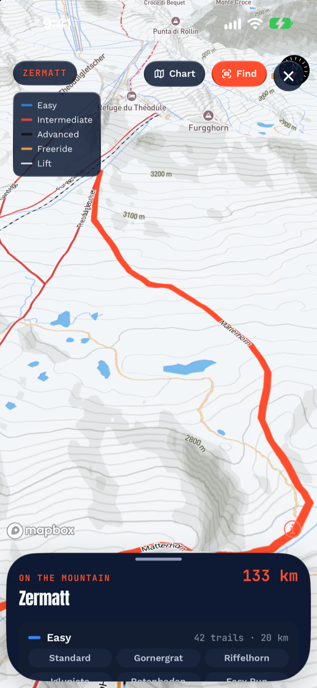

# Using the 3D winter map: a field guide

We wrote up [how the 3D winter mountain was built](/blog/3d-winter-map/).
This companion piece covers how to *use* it on an actual ski day.

## The first three seconds

Open the trail map and the camera drops from a high overview into a
pitched panorama, looking up the mountain the way a paper resort
poster does. You're seeing real elevation (gently exaggerated 1.3× so
valleys read at a glance), relief shading over snow-white terrain,
contour lines, and the resort's real OpenStreetMap piste network. The
runs are white-cased in
[European difficulty colors](https://wiki.openstreetmap.org/wiki/Key:piste:difficulty) (blue, red, black),
lifts are dashed, and names are set along the lines the way a
cartographer would set them.

Pinch, rotate and tilt all work on the mountain itself, the same as on
any modern map.

## How do you find a run on the 3D map?

Open the run list (it sits over the map as a sheet) and tap any named
run. The run glows on the terrain and the camera flies to frame it.
That answers the question trail maps exist for, *where is that,
relative to me?*, in one tap. Tap **Find** next and the
[Trail Finder](/blog/trail-finder-guide/) takes over with a camera
arrow.

## The orbit tour

The **Tour** button sets the mountain slowly rotating at 3° a second,
a full lap of the resort every two minutes. It's partly for planning,
since you see every face of the terrain, and partly, honestly, because
mountains are beautiful. Grab the map at any point and it hands
control straight back to you.

## The paper chart is still there

One toggle flips to the schematic chart: the same piste network drawn
flat on paper, north up, with no terrain. Some decisions need the
mountain and some need the diagram. The chart is also the better pick
on days without a connection, because it renders entirely from map
data already on your phone (bundled with the app for catalog resorts,
cached for the rest).

## Does the 3D map show today's snow cover?

No, it shows the mountain's shape. The terrain is Mapbox's
[elevation model](https://docs.mapbox.com/data/tilesets/reference/mapbox-terrain-dem-v1/),
which holds heights and no snow data, with winter styling on top. Land
is painted snowpack white so your eye goes to the terrain and the
colored runs. For today's snow, use the Telemetry page's freeze curve
and snow numbers, which are forecast-model values from Open-Meteo.

The base cartography is restyled at load time: land turns snowpack
white, water keeps its blue, and the relief shading carries the
shape. We chose that to make the map easier to read. On white terrain
your eye goes to the shape of the mountain and the colored runs on it,
and showing those two things is the whole job of a ski map.

Map tiles stream from Mapbox's servers. The privacy policy covers it,
and Mapbox telemetry is switched off.

*The 3D map is on the Telemetry tab behind the trail-map card's
Expand button, in [Alpy](/), free.*
