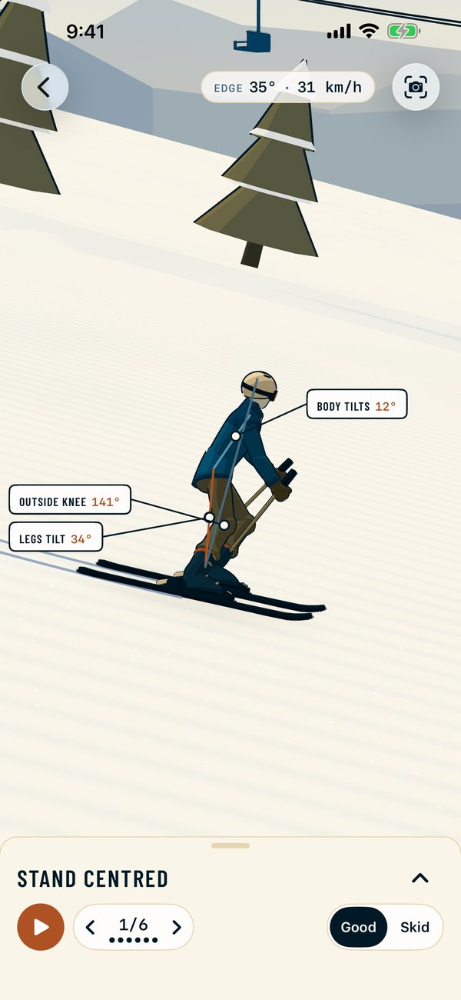
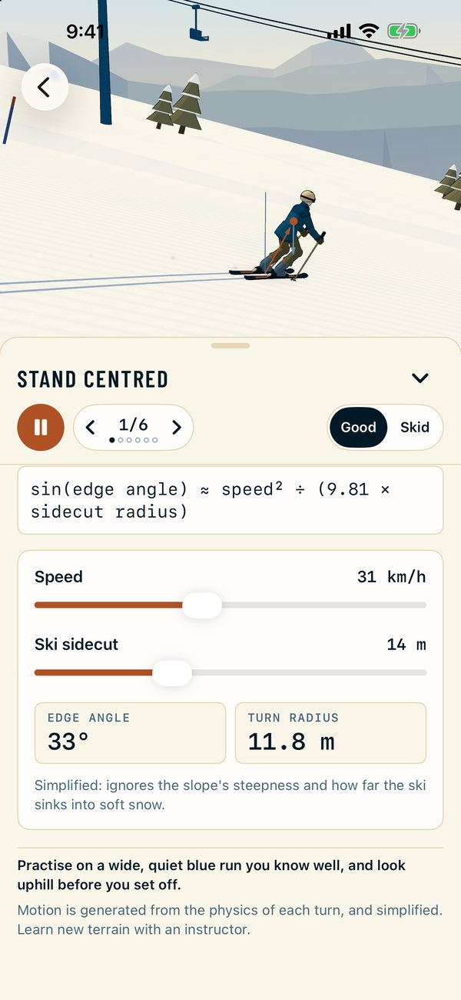

# How to carve on skis, with edge angles explained

Tip both skis onto their edges with your ankles and knees, stand
mostly on the outside ski, keep your upper body quiet, and let the
skis do the work. A tipped ski bends into an arc and follows it, so the turn comes from
the ski's shape rather than from you pushing the tails round. The more
you tip it, the tighter the arc. A clean carve leaves two thin lines
in the snow. A skid leaves a wide smear.

I built Slalo, an iPhone app that teaches skiing on an animated 3D
skier. Carving is the first lesson in its Intermediate section, and
it has a calculator for edge angle and turn radius. This post
explains the technique and the numbers, with sources for both.

## What is the difference between carving and skidding?

Ski Magazine's
[carving drills](https://www.skimag.com/performance/instruction/carving-drills/)
put it in two sentences: pushing your skis through turns results in
skidding or sliding, and tipping your skis on edge results in carving.
The same piece lists three fundamentals of carving: edging, balancing
against the outside ski, and keeping a stable upper body.

Skidding still has its place. The NC State skiing textbook's chapter
on
[turning and speed control](https://ncstate.pressbooks.pub/skiingandsnowboarding/chapter/turning-2/)
notes that skidded turns are commonly used on more difficult terrain
and when the slopes are icy.

## What is sidecut, and how does edge angle change your turn?

A carving ski is narrower at the waist, underfoot, than at the
shovel and tail. In a 2020 study of slalom skiing,
[Reid and colleagues](https://frontiersin.org/articles/10.3389/fspor.2020.00025/pdf)
define the sidecut radius as the radius of a circle through the side
of the ski at those three points. Tip the ski onto its edge and press
it into the snow, and it bends into an arc.

A simple formula from Howe's book The New Skiing Mechanics links the
two: turn radius = sidecut radius × cos(edge angle). Reid's team found
their racers' turn radii agreed well with it. Coach Ron Kipp's
[edge angle guide](https://skiracing.com/edge-angle-a-crucial-concept-for-fast-ski-racing/)
for Ski Racing works one example, a 15 m ski at 45° of edge turning on
about 10.6 m, and sums it up: increasing the edge angle decreases the
turn radius. On that same ski:

- at 30° of edge, a turn of about 13 m;
- at 45°, about 10.6 m;
- at 60°, about 7.5 m.

For a sense of scale, Carv, which makes ski sensors, showed its own
head of engineering
[reaching about 60°](https://getcarv.com/blog/why-its-almost-impossible-to-ski-like-ted-ligety)
at his best, and called that a high angle that shows advanced
technique. The drill below starts with small tipping movements on a
green run.

## How do you get the skis on edge without falling in?

By tipping with your legs more than your body. PSIA-AASI's
[alpine fundamentals](https://thesnowpros.org/wp-content/uploads/2025/01/PSIA-AASI_LearningConnection_and_Discipline-Specific_Fundamentals_2023-compressed-2.pdf)
say to control edge angles "through a combination of inclination and
angulation". Inclination is the whole body leaning into the turn.
Angulation is bending at the joints so the legs tilt more than the
upper body.

Kipp's guide to
[angulation](https://skiracing.com/mastering-angulation-key-ski-racing-technique-from-the-young-skiers-guide/)
explains the order: the skier must incline to move the
centre of mass and tip the skis, and angulation follows. He's clear
about what it is not: "It is not a lateral curvature of the spine."
And he names the fault when it's missing. The lack of angulation
results in banking, "an unbalanced and undesirable body lean". When
angulation goes wrong, he writes, the skier gets unbalanced, can't
resist the forces in the turn, and skids lower down the hill.

In the screenshot above, Slalo's Angles lens shows this on the skier:
the legs tilt further than the body.

## What is the best drill for learning to carve?

Railroad tracks. In Ski Magazine's version, you pick a groomed green
run, stand with your skis hip-width apart and push off straight down
the fall line. Gradually tip your ankles and knees to one side, be
patient and let the skis do the turning, then roll them the other
way. After two or three turns, stop and look back. Two clean lines mean you
carved. The article's advice for this stage is to begin with small
tipping movements and not expect full railroad tracks straight away.

There's a physics reason to keep it gentle. In a 2018 model of
carving turns,
[Serguei Komissarov](https://ar5iv.labs.arxiv.org/html/1812.02539)
found that pure carving becomes impossible, even in theory, on slopes
steeper than about 17° for a slalom ski with a 13 m sidecut. On
steeper runs some skidding is part of good skiing.

## How do short turns differ from carving?

In short turns the upper body stays facing down the hill while the
legs turn underneath. That's the PSIA-AASI fundamental of turning the
skis "with leg rotation, separate from the upper body". Ski Magazine's
[pivot slip](https://www.skimag.com/performance/instruction/how-to-pivot-slip/)
is a drill for it: side-slip down a narrow corridor with
your shoulders facing downhill, then pivot the skis the other way.
In PSIA-AASI Northwest's
[basic parallel](https://www.psia-nw.org/video-galleries/alpine-level-i-tasks/basic-parallel-turn/)
task, pole use is timed with the turn, and the pole touch goes with
the weight transfer and the edge change.

Slalo's Short turns lesson sits on a red: quick, rhythmic turns where
the legs turn and the body keeps facing down the hill.

## How does Slalo's carving calculator work?

You set your speed and your ski's sidecut radius, and Slalo works out
the edge angle and turn radius for a clean carve. The physics is
simplified, so treat the numbers as a guide.

The Carving lesson itself teaches you to tip the skis onto their edges
so they grip and follow a clean arc. Switch to the common mistake and
the same skier gets it wrong, so you can compare the two. The Angles
lens shows leg, body and knee angles as the skier turns, and you can
pick from five camera angles or drag to orbit.

Practise carving on a wide, quiet blue run you know well, and look up
the slope before you set off, as
[FIS rule 5](https://assets.fis-ski.com/f/252177/49280306c8/fis-code-of-conduct-for-skiers-and-snowboarders-en.pdf)
asks. Slalo teaches technique and doesn't replace an instructor.

*More on [Slalo](/slalo/). Before this:
[your first parallel turns](/blog/how-to-ski-parallel/). Carving on
hard snow is its own skill:
[how to ski on ice and hardpack](/blog/how-to-ski-on-ice/).*
