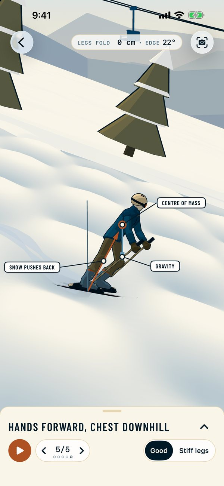
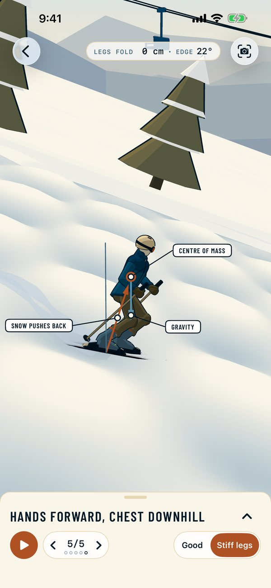

# How to ski moguls without wrecking your knees

Use your legs as suspension. Let your knees come up as you ride up a
bump, then push your feet down the back of it into the trough, so the
skis stay on the snow and your head travels in a smoother line. Keep
your hands in front, your chest facing down the hill, and your eyes a
few bumps ahead. Start on short, soft bump runs, turn on top of the
bumps at first, and stop before your legs are tired.

I built Slalo, an iPhone app that teaches skiing on an animated 3D
skier, and Moguls is one of its Advanced lessons. This post covers
the technique, and what the research says about knees and tired
legs.

## Why are moguls hard on your knees?

The knee is where skiing injuries concentrate. A 2020 study of
recreational alpine skiers in
[Knee Surgery, Sports Traumatology, Arthroscopy](https://pmc.ncbi.nlm.nih.gov/articles/PMC8126542/)
says the knee is still the most frequent injury location, at about
one third of all injuries, and that the most common knee injury is an
ACL rupture.

Tired legs are part of the picture. In a
[study of 24 recreational skiers](https://pmc.ncbi.nlm.nih.gov/articles/PMC5117052/),
eccentric hamstring strength (the muscle working while it lengthens)
was down in both legs after a 4 hour ski session, and still down 24
hours later. The authors call fatigue a potential risk factor in
recreational skiing.

I haven't found a study that measures which mogul technique is
kindest to knees, so I won't claim one. What the sources agree on is
smooth, steady pressure, a balanced stance, and starting easy.

## How do you absorb a mogul?

Fold on the way up, extend on the way down. The
[FIS judging handbook](https://assets.fis-ski.com/f/252177/x/40158d23e4/freestyle-skiing-judging-handbook.pdf)
for competition moguls describes absorption from the start of the
bump to the top, with extension starting "right after the top of the
mogul". It adds that pressure between skis and snow "should remain
the same during absorption and extension".

Laurie Todd, a CSIA Level 4 instructor, gives the recreational
version in Carv's
[guide to moguls](https://getcarv.com/blog/how-to-ski-moguls): use
your legs as suspension and try to keep your head and shoulders level.
"The key is keeping the skis on the snow to deal with pressure change
gradually." At the top of each bump, pull your feet back under you
and point your toes down to keep snow contact. Todd says it feels
like pedalling a bike backwards.

## Where should you turn in the bumps?

On top of them, to start with. Steffan Shaw, a Level 4 instructor at
Banff Sunshine, describes three ways to ski bumps in Advnture's
[guide](https://www.advnture.com/how-to/ski-bumps). The beginner's
way is "up and over": bend your knees, ski over the top of a bump,
turn on one you like, and traverse back the other way. Skiing round
the banks comes next, and the zipper line, straight down the troughs,
comes last.

Ski Utah's
[mogul drills](https://skiutah.com/blog/authors/abby-stanislaw/mastering-moguls),
which Abby Stanislaw learned from two-time Olympian Jillian Vogtli,
start the same way. Traverse across a mogul field, pull up over the front of each bump
and press down on the back, then turn the traverse into turns that
get smaller as your control improves.

## Where should your hands, eyes and poles go?

The FIS handbook asks for the head to stay still and face downhill, the hands to stay in
front of the body, and pole plants to be light. Ski Utah's tips add a
well-timed pole plant on the back side of the mogul to keep rhythm,
and an upper body that stays quiet and faces down the fall line.

For your eyes, Shaw's advice in Advnture is to look a few turns
ahead, so your brain knows where to go and your body can follow, and
to reach with your pole towards the top or back of the mogul below.

## What are the most common mogul mistakes?

Sitting back comes first. Advnture calls putting your weight too far back a
common beginner's mistake, and the fix it gives is to stay low with
your knees bent and your shins in contact with the front of your
boots. Ski Utah says the same thing in other words: let your legs do
the work by absorbing the terrain, instead of leaning back or breaking
at the waist.

Stiff legs are the other. Legs that don't fold can't act as the
suspension Todd describes. In the screenshot below, Slalo's Moguls
lesson has its common mistake switched on.

## How do you keep a mogul run safe?

Pick a short run with soft bumps, and stop at the side when you need
a rest. Rule 6 of the
[FIS Code of Conduct](https://assets.fis-ski.com/f/252177/49280306c8/fis-code-of-conduct-for-skiers-and-snowboarders-en.pdf)
asks you not to stop where the run narrows or where people above
can't see you. Rule 2 asks you to adapt your speed to your ability,
the terrain and the snow. In bumps that means turning often enough to
keep your speed down.

Then stop while your legs still feel good. The fatigue study above
found strength still down a day later, so save the bumps for when
your legs are fresh.

If you want a coach's eye, bumps are a standard topic in ski school.
PSIA-AASI Northwest lists "introduction to bump skiing" among the
typical lessons its
[Level II instructor candidates](https://psia-nw.org/wp-content/uploads/2024/11/Alpine_Certification_Guide_2024-FINAL.pdf)
must be ready to teach.

## How does Slalo teach moguls?

Slalo's Moguls lesson sits on a black run. Your legs fold over each
bump and stretch into each dip, so your head travels smoothly. Each
step plays on the 3D skier with the parts of the body that matter lit
up, and you can switch to the common mistake to compare. The Balance
lens draws the centre of mass, gravity and the push of the snow on
the skis, which shows where the skier's weight sits over each bump.
You can freeze the turn at Transition, Edging, Apex or Release, or add
a second camera view in the corner to watch from two sides at once.

Slalo teaches technique and doesn't replace an instructor. Learn new
terrain with one.

*More on [Slalo](/slalo/). Bumps build on
[short turns](/blog/how-to-carve-on-skis/), and every bump run
needs a good [way to stop](/blog/how-to-stop-on-skis/).*
