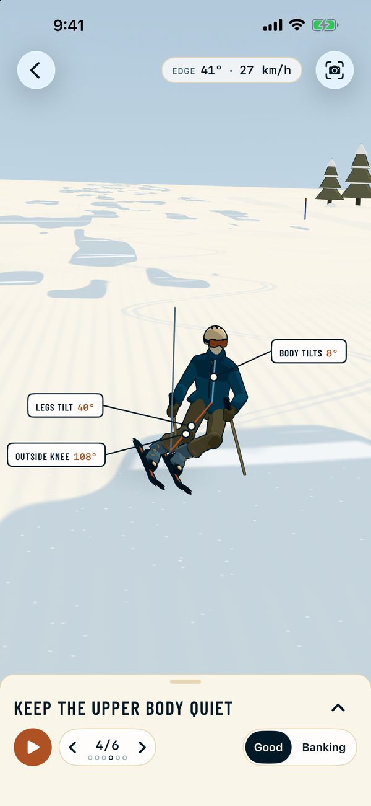
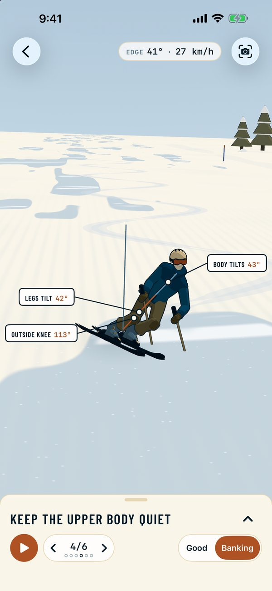
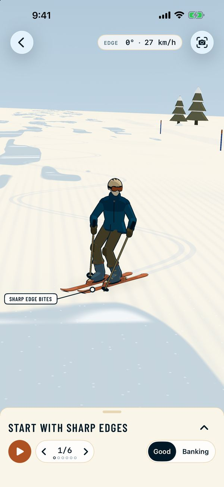

# How to ski on ice and hardpack

 

Ski a little slower and rounder than you would on soft snow. Get your
edges working early in the turn, add pressure gradually instead of
slamming the edge on, and balance on the outside ski. Tip the skis
with your legs while your upper body stays quiet, rather than leaning
your whole body into the turn. Sharp edges help, but balance matters
more.

I built Slalo, an iPhone app that teaches skiing on an animated 3D
skier, and Ice and hardpack is one of its Advanced lessons. The two
screenshots above show the idea: on the left the legs tilt far more
than the body, and on the right, the mistake, the body leans in as
far as the legs. This post explains why that matters on hard snow,
with a source for each point.

## Why is ice so hard to ski?

Two reasons: speed and grip. Laurie Todd, a CSIA Level 4 instructor,
explains both in Carv's
[guide to skiing on ice](https://getcarv.com/blog/skiing-on-ice).
Skis that don't sink into the surface pick up speed quickly. And on
most snow an edged ski sinks a little and builds a platform to stand
on, while ice is too firm for that. "Those few millimetres of metal on
the edge of your ski are all that will penetrate the surface."

The guide also names what ice does to people. As soon as they're out
of their comfort zone, old habits come back: leaning in to hug the
hill, and rocking back onto the tails.

## How do you grip on icy snow?

Balance on the outside ski. Todd calls it the key to staying on your
feet on ice. If the skis slide away from you, having your weight over
the outside foot means you slide with them, and when you want more
grip, all your weight pushes that edge into the ice. The guide warns
against bracing stiffly against the outside leg, though, because that
pushes the upper body inside and makes the skis chatter. Stack your
weight over the outside foot and stay loose.

The edging move should come earlier than on soft snow, with the skis
still pointing at 10 or 2 o'clock rather than all the way across the
hill. And because hard snow pushes back the moment you stand on it,
Carv recommends slow, deliberate movements, "just like driving on
ice".

## Why does banking make you slide out?

Because the whole body leans in with the skis. PSIA-AASI's
[alpine fundamentals](https://thesnowpros.org/wp-content/uploads/2025/01/PSIA-AASI_LearningConnection_and_Discipline-Specific_Fundamentals_2023-compressed-2.pdf)
say to control edge angles "through a combination of inclination and
angulation". Inclination is leaning the whole body. Angulation is
bending at the joints so the legs tilt further than the upper body.
Coach Ron Kipp's
[angulation guide](https://skiracing.com/mastering-angulation-key-ski-racing-technique-from-the-young-skiers-guide/)
says the lack of angulation results in banking, "an unbalanced and
undesirable body lean". He lists what follows: a slower transition, a
skier who can't resist the forces in the turn, and a skid that lowers
the line.

Kipp defines angulation as articulation between the pelvis and the
thigh bone, and is clear about what it isn't: "It is not a lateral
curvature of the spine."

## Do sharp edges matter on ice?

Yes, though they're not the whole answer. InTheSnow's
[guide to skiing on ice](https://inthesnow.com/how-to-ski-on-ice),
written by an instructor, explains that the metal edges are designed
to cut through ice when they're sharpened and pressure is applied
correctly. If your skis haven't been serviced for a long time, the
edges will be rounded and you'll struggle to find grip. Ski shops can
sharpen them, in the UK or in resort.

Carv's guide agrees that a clean, sharp set of edges makes it easier
to hold an edge on firm snow. It adds a warning before you blame your
skis, though: "balance is a lot more important than a sharp set of
planks".

## Which drills help on hard snow?

Start with a skid. Todd's first drill is to side-slip straight down
the hill, then pivot the skis to slide the other way. Then you
practise edging and flattening the skis to control your speed, and
coming to a crisp stop with your edges. PSIA-AASI Northwest's
[Level I guide](https://psia-nw.org/wp-content/uploads/2024/11/Alpine_Certification_Guide_2024-FINAL.pdf)
has the same building block: in a side-slip, flex more to increase
the edge angle and come to a stop. Practise this on a gentle, quiet
slope.

Next comes thousand steps. Alpine Canada's
[drills handbook](https://ltad.alpinecanada.org/uploads/documents/Drills_Exercises_Handbook_en.pdf)
describes small steps off a stable outside ski all the way through
the turn, with shoulders and elbows ahead of the kneecaps. It's rated
for flat to moderate terrain, and it trains you to keep moving
forward from the outside ski.

On the hill itself, read the surface. Carv's guide suggests aiming
for patches of softer snow when you need to edge hard, and simply staying balanced over the
outside foot through a slick patch until you find grip again.

## How do you stay safe on an icy day?

Slow down. Rule 2 of the
[FIS Code of Conduct](https://assets.fis-ski.com/f/252177/49280306c8/fis-code-of-conduct-for-skiers-and-snowboarders-en.pdf)
asks every skier to adapt their speed to their ability and to the
terrain, snow and weather. On hard snow, Todd's point about skis
picking up speed quickly is the reason. The NC State skiing
textbook's chapter on
[turning and speed control](https://ncstate.pressbooks.pub/skiingandsnowboarding/chapter/turning-2/)
uses round turns to control speed, and skidded turns are common on
icy slopes. Keep well away from the edges of the run too, so a turn
that slides has room.

## How does Slalo teach ice and hardpack?

Slalo's Ice and hardpack lesson sits on a red run. It teaches you to
get the edges biting early and keep your upper body quiet so the
outside ski holds. The Angles lens shows leg, body and knee angles as
the skier turns, which is how the two screenshots above show good
technique next to banking. You can pick from five camera angles,
drag to orbit, or freeze the turn at Transition, Edging, Apex or
Release.

Slalo teaches technique and doesn't replace an instructor. Learn new
terrain with one.

*More on [Slalo](/slalo/). The edge angles behind all this are
explained in [how to carve on skis](/blog/how-to-carve-on-skis/),
and the side-slip is also the way into the hockey stop in
[how to stop on skis](/blog/how-to-stop-on-skis/).*
