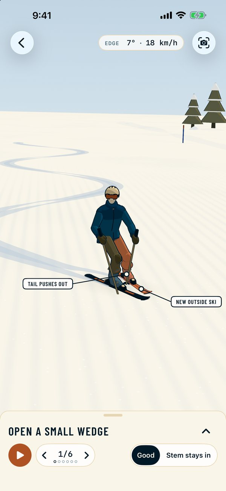
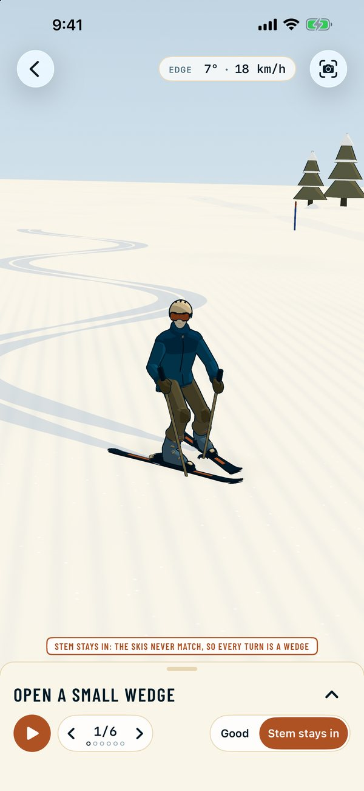

# How to ski parallel: your first parallel turns

Start each turn with a small wedge, move your weight onto the
outside ski, then slide the light inside ski in next to it. At first
the skis match near the end of the turn. Run by run you match them
earlier and make the wedge smaller, until both skis tip together and
the wedge is gone. Instructors call the in-between stage a wedge
christie, or a stem christie.

I built Slalo, an iPhone app that teaches skiing on an animated 3D
skier, and First parallel turns is its third lesson. This post
explains the move behind it, with a source for each step.

## When are you ready for parallel turns?

When you can link wedge turns down an easy slope and stop when you
choose. The NC State skiing textbook's chapter on
[turning and speed control](https://ncstate.pressbooks.pub/skiingandsnowboarding/chapter/turning-2/)
puts parallel turns after linked wedge turns and stem christie turns.
PSIA-AASI Northwest's
[Level I guide](https://psia-nw.org/wp-content/uploads/2024/11/Alpine_Certification_Guide_2024-FINAL.pdf)
uses the same order for instructors: wedge turn to wedge christie,
then wedge christie to beginning parallel. It rates the wedge
christie as green and easy blue terrain.

If stopping still feels shaky, start with
[how to stop on skis](/blog/how-to-stop-on-skis/).

## What is a wedge christie?

It's a turn that starts as a wedge and finishes parallel. PSIA-AASI
Northwest
[defines it](https://www.psia-nw.org/video-galleries/alpine-level-i-tasks/wedge-christie/)
as a turn where you steer both skis towards the fall line into a
wedge, then "the skis become parallel through more active steering of
the inside ski". It asks for rounded turns with no traversing, and it
says the skis can match at the beginning, middle or end of the turn,
depending on speed, terrain and intent. A pole touch is optional at
this stage.

The NC State textbook gives the same move in plain words: start the
turn in a wedge to give you edge and steering, then, once you have
momentum, slide the inside ski into a parallel position.

## How do you make your first parallel turn?

In four moves:

1. Open a small wedge. Push the tail of the new outside ski out, so
   it points where you want to go.
2. Move onto the outside ski. PSIA-AASI's
   [alpine fundamentals](https://thesnowpros.org/wp-content/uploads/2025/01/PSIA-AASI_LearningConnection_and_Discipline-Specific_Fundamentals_2023-compressed-2.pdf)
   include "direct pressure toward the outside ski". With most of
   your weight there, the inside ski goes light.
3. Match the skis. Slide the light inside ski in next to the outside
   one. The NC State textbook says to flatten the inside ski and skid
   it alongside.
4. Finish across the hill. Let both skis come round together until
   you slow down, then start the next turn.

Then make the wedge smaller. The NC State textbook suggests a few
runs on an easy slope where you focus only on reducing how far the
tails flare out. It also warns that a smaller wedge brakes less, so
round turns have to do the speed control instead. Over time you match
the skis earlier in the turn, until only the transition between turns
is done in a wedge.

## Why does a little speed make it easier?

Matching the skis needs some momentum. The NC State textbook ties the
matching move to the point where you have momentum, and the PSIA-AASI
Northwest definition lets speed decide where in the turn the skis
match. In practice, pick a slope gentle enough that you're happy to
let the skis run a little, instead of braking in a wedge the whole way
down.

## What are the common mistakes?

The most obvious one is a wedge that never closes. If the inside ski
stays out, every turn is still a snowplough. The screenshot below
shows Slalo's skier doing exactly that with the lesson's common
mistake switched on.

The usual cause is weight left on the inside ski, which makes it hard
to slide across. Move onto the outside ski first, as the PSIA-AASI
fundamentals describe, and the inside ski can follow.

Turning with the shoulders is another. The PSIA-AASI fundamentals ask
you to control the skis' rotation "with leg rotation, separate from the
upper body". In PSIA-AASI Northwest's
[basic parallel](https://www.psia-nw.org/video-galleries/alpine-level-i-tasks/basic-parallel-turn/)
task, the upper body is "quiet and stable with turning movements
originating in the feet and legs".

And there's leaning back, which the NC State textbook calls the most
common mistake skiers make. Keep your weight over your feet.

## Which drills help the skis match?

The NC State textbook has a simple one. While making a wedge turn
across the slope, lift the tail of the inside ski and tap it gently
on the snow a few times, then do the same on the other side. The
lifting and tapping takes weight off the inside ski, so you can bring
it in line with the outside one.

Once the wedge has gone, the pole touch comes in. In PSIA-AASI
Northwest's basic parallel task, the pole touch goes with the weight
transfer and the edge change, so it times the start of each new
turn.

## How does Slalo teach first parallel turns?

First parallel turns is the third lesson in Slalo's Beginner section,
set on a blue run. It teaches you to start each turn with a small
wedge, then bring the skis together. Each step shows on the 3D skier,
with the parts of the body that matter lit up and labels pointing at
what to watch. Each step starts at half speed so you can see the
move, then speeds up to show the flow. You can freeze the turn at
Transition, Edging, Apex or Release, which is useful for seeing
exactly when the skis come together.

When you've watched every step, a short quiz unlocks. In each of
three rounds the skier makes one turn, and you say whether it was the
good turn or the mistake.

Slalo teaches technique and doesn't replace an instructor. Try this
on terrain you can already ski comfortably in a snowplough, and learn
new terrain with an instructor.

*More on [Slalo](/slalo/). Next in this series:
[how to carve on skis](/blog/how-to-carve-on-skis/).*
