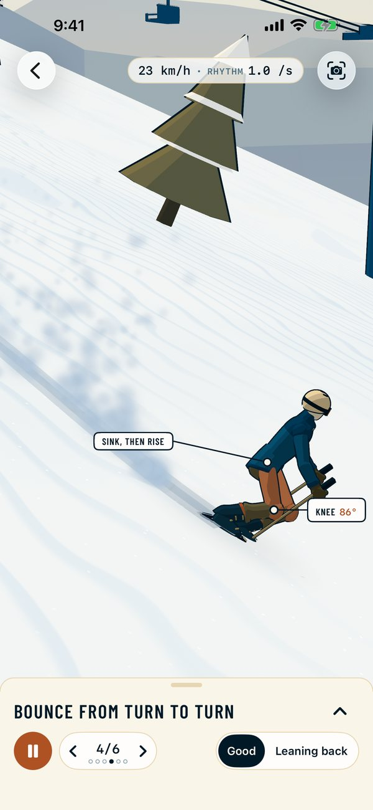
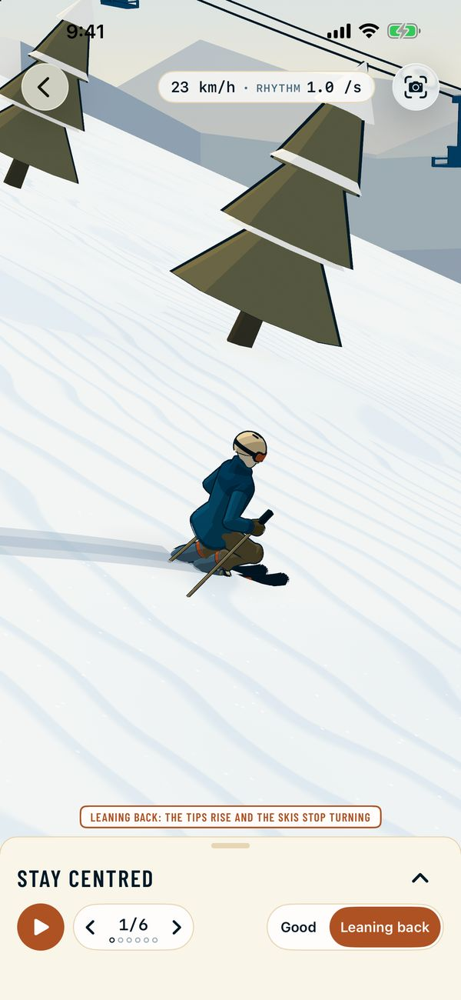
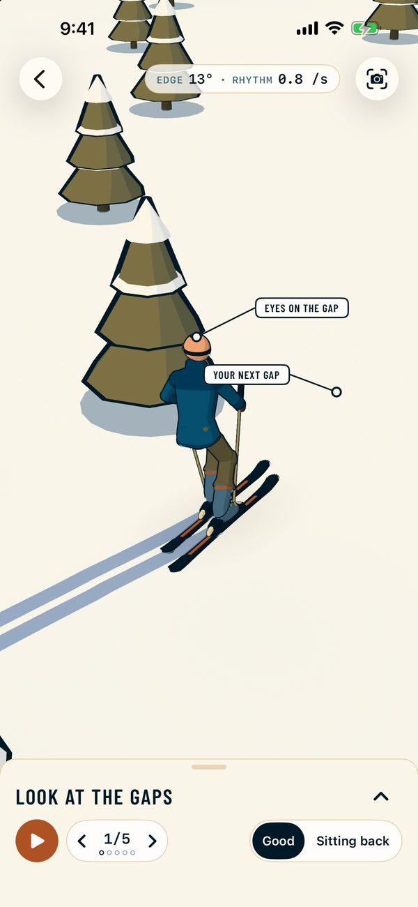
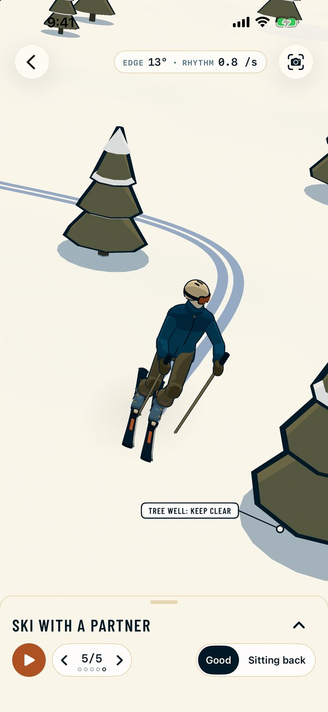

# How to ski powder and trees, and stay safe off-piste

In powder, stay centred over your skis, spread your weight evenly
across both, keep your feet a little closer than on the piste, and
use a small up-and-down bounce to link the turns. In trees, look at
the gaps rather than the trunks, keep your turns short and in control,
take your hands out of the pole straps, and stay in sight of a
partner.

Off the groomed runs, avalanches and tree wells can kill. Check the
avalanche forecast, never go alone, carry a transceiver, shovel and
probe and know how to use them, and take avalanche training. Ski your first off-piste days with an instructor
or a mountain guide.

I built Slalo, an iPhone app that teaches skiing on an animated 3D
skier, and its last two lessons are powder and trees. This post
covers the technique, then the safety, with a source for each point.

## Should you lean back in powder?

No. Ski Magazine's
[powder balance guide](https://www.skimag.com/performance/instruction/skiing-powder-balance/)
calls leaning back a myth that "just burns out your quads and makes it
even more difficult to steer". Professional skier Wendy Fischer's
advice there is to stay over the centre of your skis. The guide's
other tips: narrow your stance, spread your weight more evenly over
both skis so the outside ski doesn't dive, and flex your ankles more
than your knees.

Warren Smith's
[freeride stance guide](https://www.j2ski.com/ski_technique/Freeride/2_Closer_Stance.html)
on J2Ski says a closer stance helps the skis move together in deep
snow, but people who clamp their feet together lose their range of
movement. He suggests practising the closer stance on easy terrain
first.

## How do you turn in deep snow?

With a bounce, and enough speed to float. Canadian Mountain Holidays
guides give intermediate skiers three tips in a
[Ski Magazine piece](https://www.skimag.com/performance/how-heli-ski-pros-cmh/).
Weight both feet equally, because a weighted ski dives. Make small
vertical movements, sinking into a crouch and standing up with a
slight bounce. And remember that speed helps you stay on top of the snow, since going
too slowly leaves you weighting one ski and losing balance.

Carv's
[powder mistakes guide](https://getcarv.com/blog/5-mistakes-holding-you-back-in-powder-skiing-and-how-to-fix-them)
describes the bounce as a springboard: the up-and-down motion carries
you into each turn and sets the rhythm.

## How do you ski trees?

Look at the spaces, not the trees. That line comes from the
prevention list on the tree well safety site
[deepsnowsafety.org](https://deepsnowsafety.org/sis-prevention-equipment/),
and Last Frontier Heliskiing's
[tree tips](https://www.lastfrontierheli.com/news/tips-for-safer-tree-skiing/)
give the reason: looking at the trees as you pass them makes your
body want to ski into them.

Keep turns short and controlled. Ski Magazine's
[pivot slip](https://www.skimag.com/performance/instruction/how-to-pivot-slip/)
was written for tight trees. It lets you shed speed and change
direction in a narrow space without stopping between turns.

Take your hands out of the pole straps. Deepsnowsafety.org lists it,
and Last Frontier adds a helmet, to lower the chance of a dislocated
shoulder or skull fracture.

## What is a tree well, and why is it dangerous?

A
[tree well](https://deepsnowsafety.org/tree-wells/)
is a hollow round the base of a tree, often hidden by low branches
and filled with loose snow and air. You can't tell by looking which trees have
a dangerous well, so the site's advice is to treat them all as
dangerous.

Falling in, usually head first, can trap you under the snow. In
deepsnowsafety.org's words,
[90% of people](https://deepsnowsafety.org/what-is-a-snow-immersion-suffocation/)
in tree well research experiments could not rescue themselves. That's
why tree skiing is a partner activity. Ski with someone, keep each
other in sight at all times, and give tree wells a wide berth. Last
Frontier notes that heli and cat guides use a call system when guests
are out of sight, and its advice if you lose sight of your partner is
simple: don't just keep skiing.

## How do you stay safe from avalanches off-piste?

Do all five of these, every time.

### Check the forecast

Avalanche bulletins are written for the terrain you're heading into.
SLF, the Swiss avalanche service, says its bulletin
[only reports on unsecured terrain](https://www.slf.ch/en/avalanche-bulletin-and-snow-situation/about-the-avalanche-bulletin/capabilities-and-limitations-of-the-avalanche-bulletin/),
away from secured ski runs. Use the official service for where you
are: [SLF](https://www.slf.ch/en/) in Switzerland,
[avalanche.org](https://avalanche.org/) in the US,
[Avalanche Canada](https://avalanche.ca/), or the
[Scottish Avalanche Information Service](https://www.sais.gov.uk/)
in Scotland. The danger scale isn't linear. On SLF's
[danger level page](https://www.slf.ch/en/avalanche-bulletin-and-snow-situation/about-the-avalanche-bulletin/danger-levels/),
level 3 of 5, Considerable, is forecast for around 30% of the winter
and accounts for around 50% of avalanche deaths. At that level SLF
advises inexperienced people to stay on open ski runs. I wrote a
separate guide on
[how to read an avalanche bulletin](/blog/reading-avalanche-bulletins/).
And as avalanche.org's
[tutorial](https://avalanche.org/avalanche-tutorial/get-the-forecast.php)
puts it, the forecast is only a starting point.

### Know the terrain

According to
[avalanche.org](https://avalanche.org/avalanche-tutorial/avalanche-terrain.php),
avalanches are possible on any slope steeper than 30° and happen most
often on slopes of 35° to 50°. It lists trees among the terrain traps
that make being caught worse.

### Never go alone

Avalanche.org's
[solo travel](https://avalanche.org/avalanche-encyclopedia/human/travel-advice/solo-travel/)
entry says travelling alone greatly increases your vulnerability, and
that self-rescue is often impossible once you're buried. Its
[travel advice](https://avalanche.org/avalanche-tutorial/travel-safely.php)
is blunt: "You can't dig yourself out of an avalanche." Expose only
one person at a time to a slope that could slide.

### Carry a transceiver, shovel and probe

Avalanche.org says to
[always carry all three](https://avalanche.org/avalanche-tutorial/get-the-gear.php)
and know how to use them. The transceiver gets you close, the probe
finds the exact spot, and the shovel digs. Avalanche Canada's
[gear page](https://avalanche.ca/gear) adds that everyone in the group
needs all three: "One or two of the three isn't good enough."

### Get trained, and practise

Avalanche Canada's advice is to take a training course and practise,
because you can waste a lot of time with gear you can't use quickly. Avalanche.org's tutorial points to
[course providers](https://avalanche.org/avalanche-tutorial/get-the-training.php).
Spend your first days off-piste with an instructor or a mountain
guide.

## How does Slalo teach powder and trees?

The Off-piste section of Slalo has two lessons. Powder teaches you to
stay centred with your weight even on both skis and bounce from one
turn into the next. Trees, set in a glade, teaches you to look at the
gaps and keep your turns short and in control. You can switch either
one to its common mistake to compare.

Slalo's safety note says the same as this post: never go alone, check
the avalanche forecast, carry a transceiver, shovel and probe you know
how to use, and stay clear of tree wells. Slalo teaches technique and
doesn't replace an instructor.

*More on [Slalo](/slalo/). The short turns you need in trees are in
[how to carve on skis](/blog/how-to-carve-on-skis/).*
