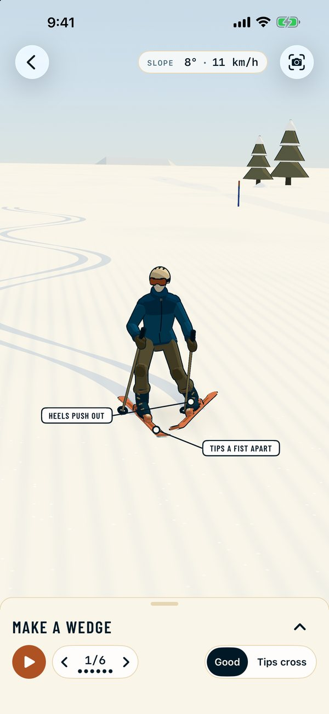
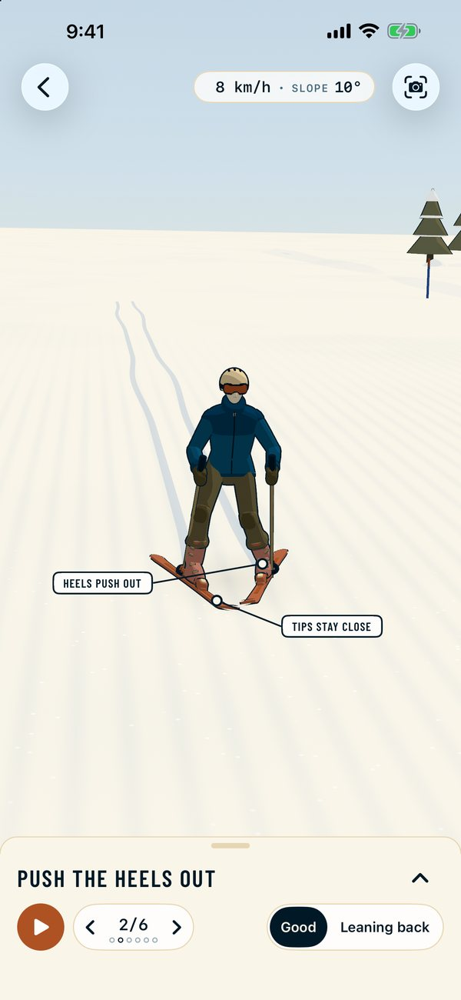
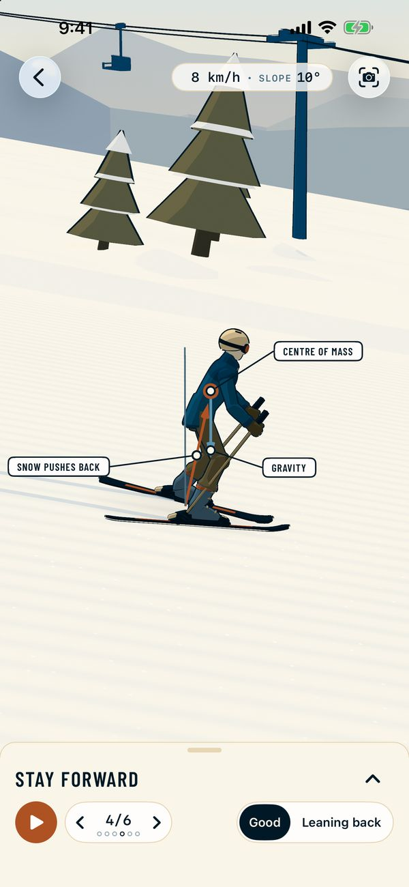
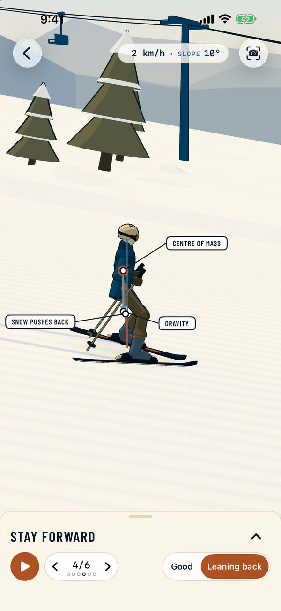

# How to stop on skis: from snowplough to hockey stop

Make a snowplough. Keep the ski tips close together and push your
heels out so the tails spread wide. The wider the wedge, the slower
you go, and a wide enough wedge brings you to a stop. Once you can ski
parallel, you can stop by turning uphill. Later still, you can learn
the hockey stop, where both skis swing sideways at once and the edges
bite.

I built Slalo, an iPhone app that teaches skiing on an animated 3D
skier. Its first two lessons are the snowplough and stopping, and
this is the technique behind them, with a source for each point.

## How do you make a snowplough?

The NC State skiing textbook
[describes the wedge](https://ncstate.pressbooks.pub/skiingandsnowboarding/chapter/introduction-to-skiing-2/)
(also called the pizza or snowplough) as ski tips "fairly close
together and tails farther apart". It says the wider you spread your
skis, the slower you go. It also warns you never to overlap the tips,
because you lose control when they cross.

Start somewhere it's safe to get it wrong. The same textbook has you
practise the wedge on flat ground first. Then you move to "a short
gentle slope with a flat run out" and let the wedge bring you to a
natural stop. To set off again, you narrow the wedge and push off
with your poles.

## Why does a wider wedge slow you down?

A wider wedge puts the skis further on edge. In PSIA-AASI Northwest's
[wedge change-ups](https://www.psia-nw.org/video-galleries/alpine-level-i-tasks/wedge-change-ups/)
task, you ski straight down a gentle slope and switch between a
parallel glide and a wedge. As the skis move farther from the centre
of your body, "the edge angle increases, slowing travel down the
hill". Steer the skis flat again and you speed up. The task also asks
you to keep your balance over the middle of both feet the whole time,
and to take as long opening the wedge as closing it.

Slalo's Stopping lesson combines the two: push your heels out and
press the inside edges until you come to a stop.

## What is the most common mistake when stopping?

Leaning back. The NC State textbook's chapter on turning calls
leaning back
["the most common mistake skiers make"](https://ncstate.pressbooks.pub/skiingandsnowboarding/chapter/turning-2/),
and asks for an athletic stance with your weight over your feet. It
feels safer to sit back when the slope looks steep, but your weight
ends up behind your feet. Advnture's guide to skiing bumps gives the
same fix for every slope:
[stay low with your knees bent](https://www.advnture.com/how-to/ski-bumps)
and your shins in contact with the front of your boots.

 

## Where should you stop on a piste?

At the side of the run, where people above can see you. Rule 6 of the
[FIS Code of Conduct](https://assets.fis-ski.com/f/252177/49280306c8/fis-code-of-conduct-for-skiers-and-snowboarders-en.pdf)
says to avoid stopping on the piste in narrow places or where
visibility is restricted, unless you have to. If you fall in a spot
like that, move clear as soon as you can. Rule 5 covers the restart:
before you set off again, look up and down the slope.

## How do you stop once you can ski parallel?

Keep turning until you face across or slightly up the hill. Your
skis run out of fall line and you slow to a stop. Advnture's
[guide to stopping](https://www.advnture.com/how-to/stop-on-skis)
describes it as turning your skis until you are facing slightly
uphill, and reminds you to watch for skiers coming down from above
while you're across the slope. PSIA-AASI Northwest's
[exercise list](https://www.psia-nw.org/wp-content/uploads/Exercises-2016.pdf)
has the same move as the stop christie: an uphill turn to a complete
stop, with a pole touch.

If parallel turns are your next step, I wrote a separate guide to
[your first parallel turns](/blog/how-to-ski-parallel/).

## How do you do a hockey stop?

Swing both skis sideways under a still upper body and set the edges.
Alpine Canada's
[drills handbook](https://ltad.alpinecanada.org/uploads/documents/Drills_Exercises_Handbook_en.pdf)
describes it as a straight run down the fall line, then "the skier
turns both skis perpendicular to the direction of travel and strongly
sets both edges". Upper body stability is the first thing on its
list. PSIA-AASI Northwest's exercise list adds the timing: drop
quickly so the skis can pivot under your torso, and keep the upper
body facing down the hill.

Build up to it with side-slips. In PSIA-AASI Northwest's
[Level I guide](https://psia-nw.org/wp-content/uploads/2024/11/Alpine_Certification_Guide_2024-FINAL.pdf),
you slip sideways down the hill with the skis across the slope, and
to come to a stop you flex more to increase the edge angle. Ski
Magazine describes the related
[pivot slip](https://www.skimag.com/performance/instruction/how-to-pivot-slip/)
as a slow-motion hockey stop. Once you can slip, pivot and stop
under control, the hockey stop is the same thing done in one move.

It does need some speed to work. Advnture notes it's harder at slow
speed, and Alpine Canada lists it for medium to steep terrain. Learn
it on a quiet, easy run you know well, away from ice, and ideally with
an instructor watching. For a beginner, the snowplough is the stop to
learn.

## How does Slalo teach stopping?

Slalo's Beginner section starts with two green-run lessons. Snowplough
glide teaches you to make a wedge, keep your speed down and press one
ski to turn. Stopping teaches you to push your heels out and press
the inside edges until you stop. Each lesson splits the technique
into a few steps. Tap a step and the skier shows it: the parts of the
body that matter light up, and labels on the body point at what to
watch. Switch to the common mistake and the same skier gets it wrong,
so you can compare the two.

The Balance lens draws the centre of mass, gravity and the push of
the snow on the skis, so you can see where the skier's weight sits.
There is no hockey stop lesson in Slalo. After the snowplough,
stopping and first parallel turns, the lessons move on to carving,
short turns, moguls, ice, steep blacks, jump turns, powder and
trees.

Slalo teaches technique and doesn't replace an instructor. Start
on a gentle beginner slope with flat ground at the bottom, and learn
new terrain with an instructor.

*More on [Slalo](/slalo/). Next in this series:
[your first parallel turns](/blog/how-to-ski-parallel/).*
